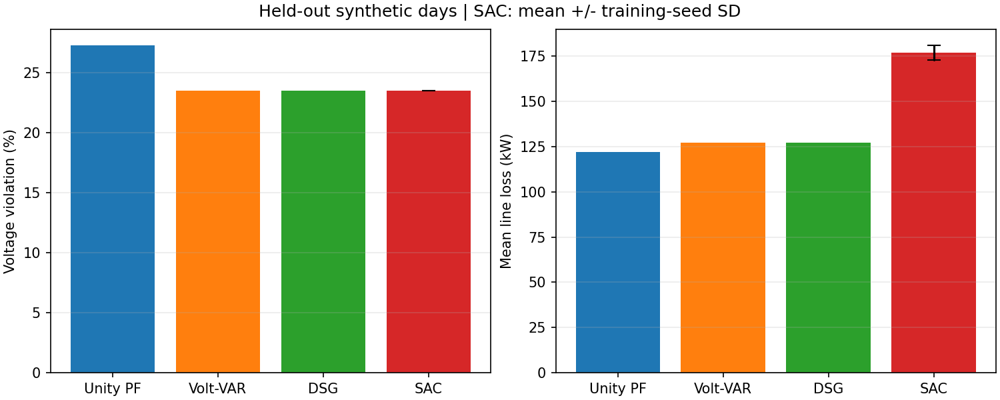

# GridGuard-RL

高比例光伏接入可能带来配电网电压越限，也会改变线路损耗。本项目在 IEEE 33 节点配电网中建立光伏无功控制仿真，比较传统控制方法与 Soft Actor-Critic（SAC），并保留可追溯的训练和评测记录。

**当前进度：**首版已完成交流潮流与合成日场景、设备无功能力约束、三种传统基线、Gymnasium 环境、SAC 三种子训练和独立测试。DSG 是带有明确项目约定的工程实现，尚未完成论文数值的完整复现；残差策略与潮流筛选仅完成小规模验证。本项目目前是本地仿真，不代表真实电网部署或严格安全保证。

我在项目中完成了电网与光伏建模、传统控制和强化学习环境实现、SAC 训练与断点保存、统一评测及结果整理。项目使用 Python、pandapower、Gymnasium、PyTorch 和 Stable-Baselines3。



## 独立测试结果

四个固定合成测试日各含 96 个 15 分钟时段；每种方法使用相同网络、输入、初始条件及逆变器能力。SAC 分别使用训练种子 7、17、27，结果为三个训练种子指标的均值 ± 样本标准差；确定性基线各运行一次。

| 方法 | 节点电压越限率 | 平均绝对电压偏差（p.u.） | 平均线路网损（kW） | 平均单设备 \|Q\|（kvar） | 平均单设备相邻 \|ΔQ\|（kvar） |
| --- | ---: | ---: | ---: | ---: | ---: |
| Unity PF | 27.273% | 0.03061 | 121.99 | 0.00 | 0.00 |
| Volt-VAR | 23.524% | 0.02829 | 127.26 | 27.36 | 27.83 |
| DSG | 23.524% | 0.02944 | 127.22 | 14.43 | 21.25 |
| SAC | 23.524% ± 0.000% | 0.02368 ± 0.00014 | 176.81 ± 4.06 | 399.78 ± 14.10 | 142.48 ± 13.79 |

越限率以**成功潮流的节点—时刻数**为分母，包含全部 33 个节点。各方法及 SAC 三个种子均完成全部测试回合，有效样本覆盖率为 100%，最终步骤潮流失败率为 0；所有方法的完整无越限回合比例均为 0。SAC 的平均电压偏差较低，但平均网损和无功动作幅度高于 DSG，不能概括为 SAC 全面优于基线。

完整记录包括 [汇总指标](./results/sac_resume_20261029/sac_formal_20261028/test_aggregate.csv)、[各场景结果](./results/sac_resume_20261029/sac_formal_20261028/test_per_scenario.csv)、[各模型结果](./results/sac_resume_20261029/sac_formal_20261028/test_per_seed.csv)、逐步电压及动作数据、[代表性电压曲线](./results/sac_resume_20261029/sac_formal_20261028/test_voltage_curves.png)。网损功率（MW）与按 15 分钟积分得到的累计损耗电量（MWh）分别记录。

## 方法与本人工作

- **网络与场景：**基于 pandapower 的 IEEE 33 节点平衡三相交流潮流，物理节点 1—33 对应内部索引 0—32；在节点 6、14、18、22、25、30、33 接入光伏。配置的光伏总有功装机约 7.43 MW、逆变器额定视在功率为各自装机的 1.2 倍；这些是项目假设。负荷和光伏曲线均为可复现合成数据。
- **设备与物理方向：**功率使用 MW/Mvar，pandapower 静态发电机正无功表示向网络注入。按照当前有功和逆变器额定容量计算 `|Q| ≤ sqrt(S²−P²)`；默认夜间不提供无功服务。输入异常与潮流失败明确记录。
- **对照方法：**Unity PF 输出零无功；Volt-VAR 使用配置的分段电压—无功曲线；DSG 依据参考论文的灵敏度和优先级思路实现，并注明论文未给出细节时采用的工程约定。DSG 不声称是作者原始代码或论文数值的完整复现。
- **SAC 环境：**观测包含当前电压、光伏和负荷、无功能力、上一步执行动作及时间信息；7 维动作映射为当前可用无功范围。每步先计算当前控制结果和奖励，再推进到下一时刻；重置、动作越界、潮流失败及终止状态均有检查。奖励包含电压偏差、网损、越限和动作变化，指标评测不只依赖累计回报。
- **训练与评测：**训练、验证、测试按完整日划分；训练集为种子 1001—1032，验证集为 2001、2002，测试集为 3001—3004，开发演示日 42、43 保留在外。三个 SAC 种子各训练 50,000 步，以验证集平均回报选择检查点，再使用固定测试集评测；原始 SAC 没有额外电压筛选层。

## 本地快速演示

以下命令在 **Windows PowerShell** 中执行。需要 Python **3.12**、Git 和网络连接；首次安装需要下载 CPU 版 PyTorch 与依赖，耗时取决于网络。本项目已锁定依赖版本，不要求 Docker。

```powershell
# 克隆后进入项目根目录；仓库公开前需使用有权限的账号
git clone https://github.com/ak10086cc/GridGuard-RL.git
cd GridGuard-RL
py -3.12 --version
.\run.ps1 -Task setup
.\run.ps1 -Task demo -Output tmp/demo_seed42
```

演示加载仓库内 **种子 7 的验证最优 SAC 模型**，在单个保留开发日上运行 Unity PF 和 SAC，各 96 步；它不是正式测试集结果，也不重新训练。当前电脑的本地演示约 14 秒，安装时间和其他机器的运行时间会不同。结果位于 `tmp/demo_seed42/`：`summary.json`、`comparison.csv`、逐步指标和逐设备动作。该输出目录必须不存在；再次运行时换一个清晰的目录名，避免覆盖旧结果。

本机测试时，从 PyTorch 官方源直接下载 CPU 安装包发生读取超时。若遇到相同问题，可先从[官方地址](https://download-r2.pytorch.org/whl/cpu/torch-2.8.0%2Bcpu-cp312-cp312-win_amd64.whl)获取对应 Windows / Python 3.12 的 wheel，放入项目的 `tmp/wheels/`，再执行：

```powershell
.\run.ps1 -Task setup -TorchWheel .\tmp\wheels\torch-2.8.0+cpu-cp312-cp312-win_amd64.whl -IndexUrl https://mirrors.aliyun.com/pypi/simple/
```

wheel 不随仓库分发；其余依赖通过指定的 Python 包源安装。干净环境验证时使用了本机已有的官方 PyTorch wheel 和上述镜像；脚本校验 CPU 版 PyTorch 版本，并允许失败后重新运行安装命令。

若仅需检查依赖或运行自动化测试：

```powershell
.\run.ps1 -Task info
.\run.ps1 -Task test
```

## 训练、模型与复现

正式训练配置位于 [configs/sac_formal.toml](./configs/sac_formal.toml)：CPU 最多两个并行进程、每进程单线程，3 个训练种子、每种子 50,000 步，每 5,000 步使用验证集选择模型并保存末尾恢复包。以下命令会启动新的长实验，需预留数小时；不要指向现有实验目录。

```powershell
.\run.ps1 -Task sac-formal -Output results/sac_formal_new
```

如需单独重新评测已分发的种子7模型和三个基线，可运行下列命令；它会计算全部四个测试日，耗时明显长于快速演示。其他种子替换模型路径和输出目录即可。三种子聚合的原始结果见前述指标文件。

```powershell
.\run.ps1 -Task sac-evaluate -SACConfig configs/sac_formal.toml -Model results/sac_resume_20261029/sac_seed7_20261028/best_model.zip -Split test -Output tmp/sac_seed7_test_recheck
```

结果目录保存了[实验配置与源码快照](./results/sac_resume_20261029/sac_formal_20261028/frozen_plan.json)、各种子的训练/验证曲线数据、三份验证最优 `best_model.zip`、测试原始指标和图表。原实验训练时的源码保存在同目录的 `source_snapshot.zip`；后续增强和演示开发使当前源码版本与训练时快照不同。末尾恢复包和较早的中间实验不随仓库分发。新的实验结果默认被 `.gitignore` 忽略，需要发布时再审查并明确纳入。

模型文件包含 Stable-Baselines3 序列化内容，加载时只使用可信来源。分发的模型由本项目使用合成场景训练，没有加载外部预训练权重。原研究论文 PDF 仅本地查阅，不随仓库分发。

## 已知局限

- 本项目只测试了一个网络及有限合成日，没有实测数据、硬件验证或跨网络泛化结论。电压范围 0.95—1.05 p.u. 是实验配置，并非接入标准合规声明。
- 夜间关闭无功服务时存在无法由这些设备修正的欠压。潮流收敛、完成回合与电压全部合格是不同指标。
- DSG 的部分参数和实现细节采用明确的项目约定；论文原有结果没有计入本项目结果。
- [残差与有限次数潮流校验](./gridguard/enhanced.py)已通过小规模功能测试，但尚未进行正式训练或独立消融。对预先越限的工况，筛选可能接受不加重越限的动作，不能将其称为严格安全。

## 项目结构

```text
configs/       网络、基线、环境及训练配置
gridguard/     潮流、控制器、环境、训练、评测与演示入口
tests/         物理约束、环境、基线、训练及恢复检查
results/       首版正式结果、模型、图表、配置和原始指标
run.ps1        Windows 安装、演示、训练与测试入口
run_enhanced.ps1  可选增强模块入口；未开展正式增强实验
tmp/           可删除的缓存、临时检查与试跑输出，不提交
```

## 许可与来源

本仓库用于个人项目展示与复现说明，目前未授予开源许可，也未添加 `LICENSE` 文件；后续如授权复用，将单独明确许可范围。第三方依赖仍遵循各自的许可证；论文 PDF、外部预训练模型及分发条件不明的资料不随仓库提交。引用论文方法不表示拥有论文或原作者代码的分发权。

## 参考资料

- Dong Yang, *Dual Sensitivity Guided Reactive Power Control for Enhanced Photovoltaic Hosting Capacity in Distribution Networks*，方法背景与 DSG 公式参考。
- [pandapower 测试电网说明](https://pandapower.readthedocs.io/en/stable/networks/power_system_test_cases.html)、[MATPOWER case33bw 参数](https://matpower.org/docs/ref/matpower6.0/case33bw.html)、[pandapower 静态发电机符号](https://pandapower.readthedocs.io/en/stable/elements/sgen.html)。
- [Gymnasium API](https://gymnasium.farama.org/api/env/)、[Stable-Baselines3 SAC](https://stable-baselines3.readthedocs.io/en/master/modules/sac.html)。
